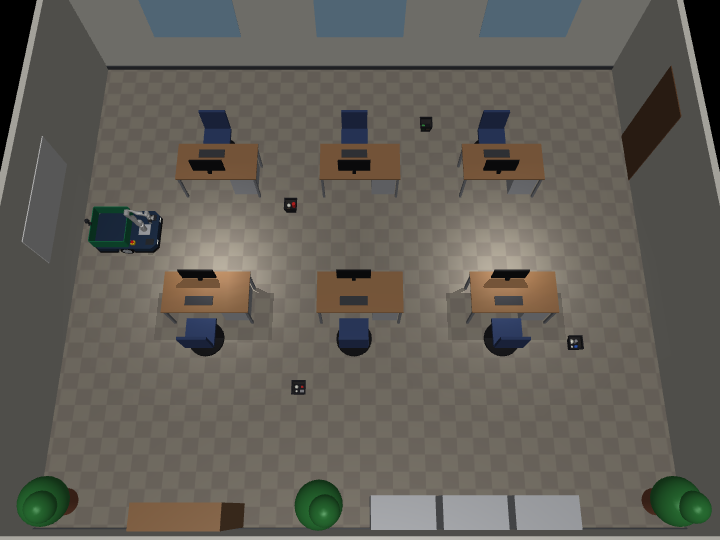

# ROBOT-REC: robot recolector de basura para oficinas (MuJoCo / Genesis)

Robot móvil de tracción diferencial con tolva y brazo **Kinova Gen3** que recorre una oficina y vacía en su tolva las **papeleras de malla** repartidas por ella.

En cada papelera:

1. Llega por los pasillos.
2. Se alinea y pasa con la papelera a su izquierda (carga lateral), deteniéndose a su lado.
3. El Gen3 pinza el aro superior de la pared que mira al carro.
4. La lleva en arco hasta encima de la tolva y la invierte para vaciarla.
5. La devuelve vacía a su sitio.



## Instalación

```bash
python -m venv .venv
.venv\Scripts\pip install mujoco numpy
```

Solo si tienes GPU NVIDIA con CUDA (para Genesis):

```bash
.venv\Scripts\pip install torch --index-url https://download.pytorch.org/whl/cu124
.venv\Scripts\pip install genesis-world
```

## Uso

```bash
.venv\Scripts\python simular.py
```

Usa **Genesis** si `torch.cuda.is_available()` y **MuJoCo** en caso contrario.
- `--motor mujoco|genesis` fuerza uno de los dos.
- `--sin-ventana` corre sin visor.

Al terminar informa cuántos residuos quedaron en la tolva y, para cada papelera, a qué distancia de su sitio quedó y si quedó de pie. Sale con código 1 si falta algún residuo o alguna papelera quedó a más de 5 cm o volcada.

Antes de simular, una autoprueba recorre solo con la cinemática la trayectoria del brazo en un ciclo y falla si la IK tendría que saltar de postura.

## Configuración del escenario

Todo se define al inicio de `oficina.py`:
- `TAREAS`: posición de cada papelera, rumbo de aproximación del robot y puntos de paso por los pasillos.
- `BASURA`: residuos de cada papelera (bolas, latas o cajas, con medidas, masa y color).
- `INICIO`: pose inicial del robot.

`oficina.xml` se regenera al ejecutar `simular.py`, así que no se edita a mano. El robot mide 1,1 × 0,72 m y, al girar en el sitio, barre un círculo de ~0,66 m de radio: los pasillos deben dejar ese espacio libre.

## Componentes

| Archivo | Contenido |
|---|---|
| `simular.py` | Navegación, rutina del brazo, IK del Gen3 y backends MuJoCo / Genesis |
| `oficina.py` | Escenario: genera `oficina.xml` y define papeleras, basura y rutas |
| `robot_rec.xml` | Robot (MJCF): base, ruedas, tolva, Gen3, pinza, actuadores, IMU y cámara |
| `papelera.xml` | Papelera de malla (MJCF) |
| `escena.xml` | Escena MuJoCo: piso + oficina + robot |
| `meshes/` | Mallas STL del robot y la papelera; `meshes/gen3/` son las del Kinova Gen3 |

- **Base:** 110×72 cm y 35 kg, con 2 ruedas motrices centrales, 4 ruedas locas, banda-parachoques con sensores ToF, paro de emergencia y LiDAR 360°.
- **Tolva:** ~95 L.
- **Brazo:** Kinova Gen3 de 7 DOF. Las mallas, inercias y ganancias vienen de [MuJoCo Menagerie](https://github.com/google-deepmind/mujoco_menagerie/tree/main/kinova_gen3) (licencia BSD-3, ver `meshes/gen3/LICENSE`).
- **Pinza:** paralela, de dedos acoplados y 120 N por dedo, con almohadillas de caucho.
- **Papelera:** de malla metálica, troncopiramidal (base 17 cm, boca 21 cm, alto 20 cm), con aro superior rígido y reborde.
